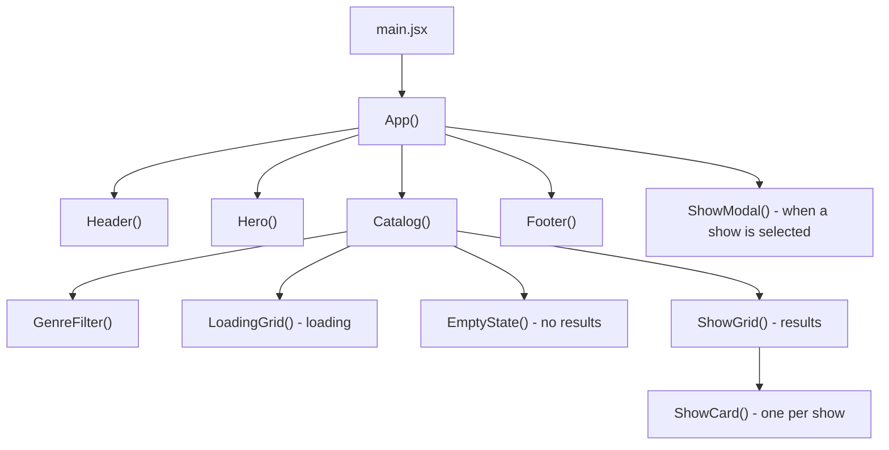
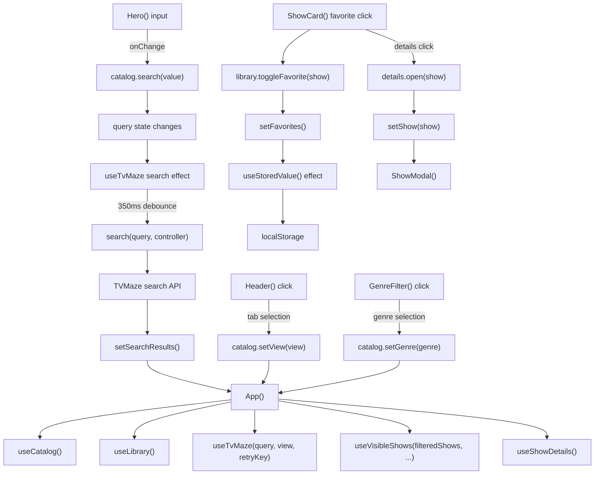

# Reelwatch

TV show finder built with React, Bootstrap, and the TVMaze API.

Run from this folder:

```sh
npm install
npm run dev
```

## 1. Component flow

This shows which components render other components. `Catalog` chooses one result component depending on the current state.



## 2. Function flow

This shows the main functions/hooks and what happens after user actions.



## Function guide

| Function / hook | What it does |
| --- | --- |
| `App()` | Calls the hooks, filters/selects shows, and connects components. |
| `useCatalog()` | Stores search text, current tab, genre, and retry action. |
| `useTvMaze()` | Loads shows and searches TVMaze; `search()` makes the search request. |
| `useLibrary()` | Manages favorites, watchlist, and demo user; `toggle()` adds/removes a show. |
| `useStoredValue()` | `readValue()` loads saved state; an effect writes updates to local storage. |
| `useVisibleShows()` | Returns the current page; an observer adds more shows on scroll. |
| `useShowDetails()` | `open()` selects a show and loads details when needed. |
| `Hero()` | Calls `catalog.search()` when the search input changes. |
| `ShowCard()` | Calls favorite, watchlist, or details actions when its buttons are clicked. |
| `Catalog()` | Chooses loading, empty, error, or show-grid UI. |

`useState` keeps values between renders. When a setter updates state, React renders `App()` again with the new values. Props carry data and functions from parent components down to child components.
