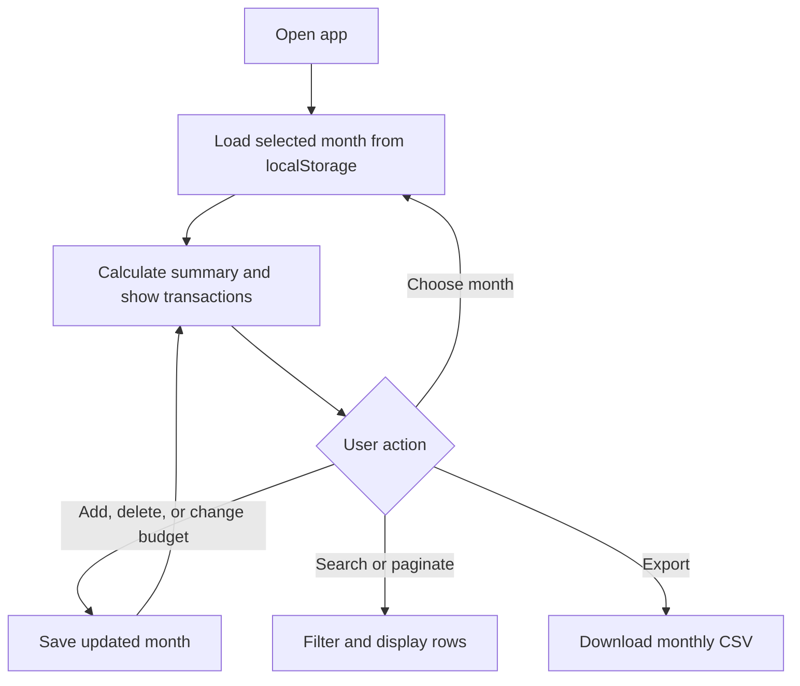
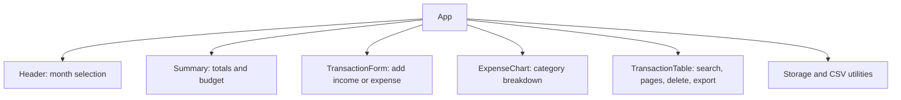

# Expense Tracker

A responsive React and Bootstrap app for tracking monthly income, expenses,
budgets, and category spending in Indian rupees.

## Run locally

```sh
npm install
npm run dev
```

Run `node --test tests/*.test.js`, `npm run lint`, and `npm run build` to
validate. Data is stored in this
browser's localStorage; clearing browser data removes it. Select a month in
the current April–March financial year. Transactions are saved to the selected
month, regardless of the date entered. CSV export includes all transactions
in that month, not just search results.

## Function flow



## Component flow



## React concepts through real-life analogies

- **Components** are like rooms in a house: each has a focused purpose.
- **Props** are like instructions passed from a manager to a team member.
- **State** is like a whiteboard: changing it updates what everyone sees.
- **Events** are like doorbells: a click or submission triggers an action.
- **Controlled inputs** are like a shared notepad: React keeps the displayed
  form values in sync with its state.
- **Effects** are like an artist repainting a chart when its data changes.
- **List keys** are like name tags, helping React identify each transaction.

The chart uses a canvas for the pie and a text legend for accessible values;
Bootstrap's responsive grid and table handle smaller screens.
